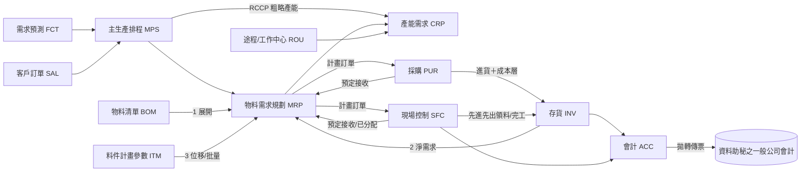

# 資料助秘之物料需求II生產製造系統 — 資料庫規劃

| 項目 | 內容 |
|---|---|
| 資料庫 | MariaDB 11.x（InnoDB、utf8mb4），資料庫名稱 `zms_mrp2`，內建埠 **3398**（沿用資料助秘家族 3318/3338/3358/3378 的排法） |
| 規模 | 14 個模組、**95 張資料表**、1,080 個欄位（全部有繁中備註）、336 條外鍵、68 條檢查約束 |
| 檔案 | `db/schema_spec.py`（規格，唯一來源）→ 產生 `db/schema.sql` 與 `docs/資料表欄位明細.md` |
| 驗證 | `db/sample_data.sql`（電子組裝廠範例）＋ `tests/verify_mrp.sql`（實跑 MRP、CRP、先進先出）已在 MariaDB 11.8 通過 |
| 參考 | 資料夾內 `mrp.sql` 系列草稿、`mrp.md.docx`、`MRP.pdf`（MRP II 十一模組）、`生產循環.pdf`（REA 模型）、`MRP II.pdf`（表單編號統一） |

---

## 一、設計原則

1. **前三碼 = 功能模組**：`itm_item` 屬料件模組、`mrp_record` 屬 MRP 模組，一看表名就知道歸屬與權限。
2. **表名、欄名一律小寫**：Windows 版 MariaDB 預設不分大小寫、Mac 版會分，小寫才能在五個平台通用。
3. **代理主鍵**：每張表用 `id` 當主鍵，料號、單號另設唯一鍵 → 料號改名不必連動上百張單據。
4. **單頭／單身**：所有單據都是 `_h`（單頭）＋`_d`（單身），刪單頭時單身一併刪除（CASCADE）；其他外鍵一律禁止刪除被參照資料（RESTRICT），避免把還在用的料件刪掉。
5. **繁中備註**：每張表、每個欄位都有 `COMMENT '繁體中文說明'`，用 HeidiSQL、DBeaver 等工具打開就看得到；產生器會擋下沒寫說明的欄位。
6. **共同欄位**：主檔與單頭都帶 `created_at / created_by / updated_at / updated_by`，搭配 `sys_audit_log` 做稽核。
7. **數值精度**：數量 `DECIMAL(18,4)`、單價與匯率 `DECIMAL(18,6)`、金額 `DECIMAL(18,2)`；不用浮點數，避免 MRP 與匯率累算誤差。
8. **狀態碼**：單字元代碼並以 CHECK 限制（如 D 草稿、A 核准、C 結案、X 作廢），畫面再顯示中文。
9. **存貨單一真相**：所有入出庫寫入 `inv_txn` 流水帳；`inv_balance` 是加速查詢的餘額、`inv_layer` 是先進先出成本層，兩者都可由流水帳重建。

---

## 二、模組與資料表總覽

| 前綴 | 模組 | 張數 | 主要資料表 |
|---|---|---|---|
| SYS | 系統管理 | 12 | 公司、參數、**資料庫版本（系統更新用）**、功能、角色、權限、使用者、單據類別／流水號、操作紀錄、**語音教學說明** |
| BAS | 基本資料 | 10 | 單位、**幣別、匯率歷史**、**國家／產地、製造商**、部門、員工、倉庫、儲位、工廠行事曆 |
| ITM | 料件主檔 | 6 | 分類、料件、**料件版本**、**核可製造商料號 AML**、料件計畫參數（1:1）、單位換算 |
| FCT | 需求預測 | 3 | 產銷計畫（S&OP）、預測單頭／單身 |
| SAL | 客戶訂單 | 5 | 客戶、訂單單頭／單身、出貨單頭／單身 |
| ROU | 途程與工作中心 | 5 | 工作中心、例外產能、機器設備、途程單頭／工序 |
| BOM | 物料清單 | 4 | BOM 單頭／單身、替代料、工程變更 ECN |
| MPS | 主生產排程 | 3 | MPS 單頭、時距明細、需求對應（多對多） |
| MRP | 物料需求規劃 | 5 | 執行批次、**MRP 時距表**、計畫訂單、需求追溯、例外訊息 |
| CRP | 產能需求規劃 | 4 | 資源清單（RCCP）、產能批次、工作中心負荷、負荷來源 |
| PUR | 採購 | 8 | 供應商、料件供應來源（多對多）、請購、採購、進貨驗收 |
| SFC | 現場控制 | 10 | 工單、工單用料、工單工序、請料、領退料、報工、移轉、完工入庫 |
| INV | 存貨控制 | 11 | 批號、庫存餘額、異動帳、**先進先出成本層、成本層耗用**、調撥、調整、盤點 |
| ACC | 會計與財務分析 | 9 | 會計期間、科目對應、工作中心費率、料件成本、存貨月結、工單成本、差異、拋轉傳票 |

> 對應五大模組：①需求預測與客戶訂單 = FCT＋SAL；②MPS 與 CRP = MPS＋CRP（＋ROU 產能基礎）；③BOM 與 MRP = BOM＋MRP（＋ITM）；④採購、現場控制、存貨 = PUR＋SFC＋INV；⑤會計與財務分析 = ACC。SYS、BAS 為共用底層。

---

## 三、整體資料流

---

## 四、MRP 三大輸入與三大步驟對應的資料表

| MRP 概念 | 資料表 | 關鍵欄位 |
|---|---|---|
| 主生產排程 MPS | `mps_plan_h`、`mps_plan_d` | `mps_qty`、`period_start`、`frozen_until` |
| 物料清單 BOM | `bom_header`、`bom_detail` | `qty_per`、`base_qty`、`scrap_rate`、`effective_date`、`child_rev_id`、`required_country` |
| 存貨記錄檔 | `inv_balance`、`bas_warehouse.is_nettable`、`itm_revision.status`、`itm_plan.safety_stock` | 現有量、保留量、安全存量；待驗倉與淘汰版本不計入 |
| 已訂購未到貨 | `pur_order_d`（`qty − received_qty`）、`sfc_work_order`（`plan_qty − completed_qty`） | 預定接收 |
| ① 展開 Exploding | `itm_item.low_level_code` 決定計算順序（共用料取最深層）；下階毛需求 = 上階**計畫訂單** ÷ 基準量 × 用量 ÷ (1 − 損耗率) | |
| ② 淨需求 Netting | `mrp_record` | 淨需求 = MAX(0, 毛需求 − (現有 − 保留 − 安全存量) − 預定接收) |
| ③ 位移 Offsetting | `itm_plan.lead_time_days` ＋ `bas_calendar.workday_seq` | 發出日 = 需求日往前推 N 個**工作天** |
| 批量法則 | `itm_plan.lot_rule`（LFL／FOQ／EOQ／POQ）、`order_multiple`、`min_order_qty` | 電容整捲 2000、MOSFET 500 倍數… |
| 產出 | `mrp_planned_order`（建議單）、`mrp_pegging`（追溯）、`mrp_exception`（行動訊息） | |

> 舊草稿 `sp_MRP_Calculate` 是把**毛需求**直接乘下去，會忽略半成品庫存；新設計依低階碼逐階計算，下階需求來自上階的**淨需求計畫單**，這才是正確的 MRP。

---

## 五、電子業專屬設計

### 5.1 料件版本（同料號不同版本）
- `itm_revision`：料號 × 版本碼（A、B、1.0、1.1），狀態 D 設計中／P 試產／A 量產／H 暫停／O 淘汰，含生效／失效日、韌體版本、圖號、Gerber 路徑、前一版、對應 ECN。
- `is_interchangeable`：可與前版互換（如 Hub IC 韌體 1.0→1.2）→ MRP 合併計算；不可互換（如 PCB Rev A→B 改線路）→ 淘汰版庫存**不計入**可用量。
- **28 張表**帶版本欄位，並自動建立 `(料件, 版本)` 複合索引，共 49 個版本索引：BOM（母件版本、元件指定版本、替代料版本）、途程、ECN（變更前後版本）、供應來源、訂單、出貨、計畫訂單、請購、採購、進貨、工單、工單用料、請料、領料、完工、批號、庫存餘額、異動帳、成本層、調撥、調整、盤點、料件成本。
- 庫存餘額唯一鍵 = 料件 × 倉庫 × 儲位 × 批號 × **版本**。

### 5.2 產地（台製、日製、美製、韓製…）
- `bas_country`：ISO 兩碼與產地簡稱（TW 台製、JP 日製、US 美製、KR 韓製、CN 陸製、MY 馬製）。
- `bas_manufacturer`：原廠（與供應商分開，供應商可能是代理商）。
- `itm_mfr_part`（AML 核可製造商料號）：料件 × 版本 × 製造商 × 製造商料號 MPN × **原產國** × 優先序 × RoHS。
- `bom_detail.required_country`：指定產地（例：電源 PCBA 的固態電容客戶要求日製），工單用料帶入 `sfc_wo_material.required_country`。
- 供應來源、採購單身記錄指定製造商料號與產地；**進貨與批號**記錄實收產地、Date Code、原產地證明書號，可追溯每片板子用的是哪國料。

### 5.3 幣別與匯率
- `bas_currency`：幣別、符號、是否本位幣、金額小數位（日圓、韓元為 0）、最新記帳匯率。
- `bas_exchange_rate`：幣別 × 日期 × 匯率類型（B 銀行買入、S 銀行賣出、M 中價、A 記帳），單據依單據日自動帶入。
- 訂單、出貨、採購、進貨單頭皆有 **幣別、匯率、本位幣未稅金額、本位幣稅額**；單身有 **本位幣金額**。
- 成本差異 `acc_variance` 增加 **FXV 匯兌差異**（採購日與付款／進貨日匯率不同）。

### 5.4 先進先出（FIFO）
- `itm_plan.issue_rule`：F 先進先出（預設）、E 先到期先出、M 人工指定；`cost_method`：F 先進先出（預設）、W 月加權、S 標準成本。
- `inv_lot.received_at`：批號入庫時間，發料建議依此排序。
- `inv_layer`：每次入庫一層（入庫量、剩餘量、**本位幣**單位成本，外幣進貨已換算）。
- `inv_layer_consume`：出庫異動 × 成本層（多對多），記錄每筆出庫吃掉哪幾層、多少量、多少成本。
- 發料時**避開已保留量**（如保留給指定日製工單的電容），其餘依入庫先後扣減。

---

## 六、驗證結果（電子組裝廠範例）

**MPS**：主機板 300 片 12/18 交（美元訂單）、650W 電源 200 台 12/15 交（美元）、USB 集線器 500 個 12/1 交（台幣）。

| 料號 | 階 | 毛需求 | 預定接收 | 淨需求 | 計畫量 | 發出日 | 重點 |
|---|---|---|---|---|---|---|---|
| F-MB-A1 | 0 | 300 | 0 | 290 | 290 | 12/16 | 庫存 20 − 安全 10 |
| S-PCBA-PSU | 1 | 195 | 80 | 115 | 115 | 12/09 | 生產中工單剩 80 片 |
| R-PCB-MB | 2 | 260 | 0 | 220 | **250** | 11/30 | 淘汰 Rev A 120 片**不計**，只算 Rev B 40；50 倍數 |
| R-CHIPSET | 2 | 260 | 150 | 30 | 30 | 11/23 | 待驗倉 50 個不計；美元在途 150 |
| R-HUBIC | 2 | 470 | 0 | 420 | 420 | **11/11** | 前置 12 工作天 → **已逾期警示** |
| R-CAP（共用） | 2 | 940／690／3151.5 | 2000 | 0 | — | — | 三個母件共用、三個需求日依序扣；日圓在途 2000 |
| R-MOSFET（共用） | 2 | 460／2101 | 0 | 0／1361 | 0／**1500** | 12/07 | 500 倍數 |
| R-USBA（共用） | 2 | 1880／1040 | 0／600 | 1080／420 | 1100／500 | 11/19／12/04 | 部分到貨的在途量只算一次 |
| R-WIRE | 3 | 410.7 | 0 | 0 | — | — | 115 × 3.5 ÷ 0.98（損耗 2%） |

**需求追溯（固態電容）**：11/27 940 個來自集線器 PCBA、12/09 690 個來自電源 PCBA、12/14 3151.5 個來自主機板 PCBA。

**先進先出**：主機板試產領 3500 個電容 → 先扣 10/05 入庫的日製批 2700 個 @2.6（保留給電源工單的 300 個不動），再扣 10/20 台製批 800 個 @1.8，成本 8,460 元、平均 2.4171。

**外幣**：日圓採購 ¥24,000 × 0.2138 = NT$5,131；美元採購 US$2,775 × 32.05 = NT$88,939。

---

## 七、關聯型態說明

### 一對一（1:1）
| 主表 | 從表 | 說明 |
|---|---|---|
| `itm_item` | `itm_plan` | 料件基本資料與計畫參數拆開，主檔畫面簡潔、MRP 只讀計畫參數 |
| `bas_employee` | `sys_user.employee_id`（唯一） | 一位員工最多一個登入帳號 |
| `sys_company` | （固定 1 筆） | 單一公司設定 |

### 一對多（1:N）／多對一（N:1）
- 所有單頭 → 單身：`sal_order_h` 1:N `sal_order_d`、`pur_order_h` 1:N `pur_order_d`、`sfc_work_order` 1:N `sfc_wo_material`／`sfc_wo_operation`…
- 主檔被交易參照：`itm_item` 1:N `itm_revision`、`itm_mfr_part` 及幾乎所有單身；`bas_currency` 1:N `bas_exchange_rate` 與所有外幣單據；`bas_country` 1:N `bas_manufacturer`、`itm_mfr_part`、`inv_lot`
- 運算批次：`mrp_run` 1:N `mrp_record`／`mrp_planned_order`／`mrp_pegging`／`mrp_exception`
- 自我參照（樹狀）：`bas_dept.parent_id`、`itm_category.parent_id`、`bas_employee.supervisor_id`、`itm_revision.prev_rev_id`、`sfc_work_order.parent_wo_id`、`sfc_wo_material.substitute_for_id`
- 從單身角度看就是多對一（N:1），欄位明細文件在「關聯」欄逐一標示。

### 多對多（M:N）— 以橋接表實作
| 兩端 | 橋接表 | 橋接表上的屬性 |
|---|---|---|
| 料件（母件）× 料件（元件） | `bom_header` ＋ `bom_detail` | 用量、損耗率、生效期間、指定版本、指定產地 |
| 料件 × 製造商 | `itm_mfr_part` | 製造商料號、原產國、優先序 |
| 料件 × 供應商 | `pur_item_source` | 製造商料號、產地、外幣單價、交期、MOQ |
| 料件 × 工作中心 | `rou_routing_h` ＋ `rou_routing_d`；RCCP 用 `crp_bill_resource` | 整備／加工工時 |
| 使用者 × 角色 | `sys_user_role` | — |
| 角色 × 功能 | `sys_role_perm` | 查詢／新增／修改／刪除／核准／列印 |
| MPS 明細 × 訂單/預測明細 | `mps_demand_link` | 對應數量 |
| 計畫訂單（上階）× 計畫訂單（下階） | `mrp_pegging` | 需求量、需求日 |
| 出庫異動 × 先進先出成本層 | `inv_layer_consume` | 耗用量、單位成本、金額 |
| 請料 × 發料（REA 履行） | `sfc_issue_h.req_id`、`sfc_issue_d.req_line_id` | 一張請料可分多次發 |

---

## 八、生產循環 REA 模型對照（參考《生產循環.pdf》）

| REA 元素 | 本系統資料表 |
|---|---|
| 製造命令 | `sfc_work_order` |
| 請料／保留 | `sfc_request_h`／`sfc_request_d` |
| 發料／存量-流量1 | `sfc_issue_h`／`sfc_issue_d` ＋ `inv_txn` ＋ `inv_layer_consume` |
| 生產運轉（批次）／存量-流量4 | `sfc_complete`（生產批號 `lot_no`） |
| 人力操作、機器操作（計工單） | `sfc_report`（`report_type` L/M、`employee_id`、`machine_id`） |
| 機器設備（成本、耐用年限、殘值） | `rou_machine` → 供 `acc_wc_rate` 製費率計算 |
| 移轉單 | `sfc_move` |
| 連結1（成品 × 原料耗用量） | `bom_detail` |
| 連結2（成品 × 人力型態） | `rou_routing_d` |
| 生產線主管／員工 | `bas_employee`（`supervisor_id` 自我參照） |

---

## 九、與系統需求的對應

| 需求 | 資料庫支援 |
|---|---|
| 系統更新功能 | `sys_schema_version`：程式更新後依版本逐一套用升級腳本，已套用的不重跑 |
| 語音教學說明文件 | `sys_help_topic`：每個功能一篇說明（Markdown）＋語音朗讀稿 |
| 權限 | `sys_role`、`sys_role_perm`、`sys_function` |
| 表單編號統一 | `sys_doc_type`（單別、前綴、格式、存貨方向）＋`sys_doc_seq`（每月流水號） |
| 拋轉一般公司會計 | `acc_account_map`＋`acc_voucher_h/d`（匯出檔或 API 傳送，與進銷存、人事薪資相同模式），金額一律本位幣 |
| 手機／平板 | 手機與 iPad 透過電腦端 API 存取同一個資料庫，不另建資料表 |

---

## 十、留給 Python 運算引擎的強化項目

驗證用 SQL 程序只為證明結構可行，正式引擎再補上：
1. **重排程訊息**：在途採購晚於需求日時發「EXP 提前」（例：USB 母座在途 11/28 到、需求 11/27）。
2. **指定產地的分開淨算**：`required_country = 'JP'` 的需求只能用日製批與日製在途。
3. **EOQ 與 POQ 批量**（欄位已備妥：年需求量、訂購成本、持有成本率、合併期數）。
4. **有限產能排程**：CRP 超載時建議移單、加班或外包。
